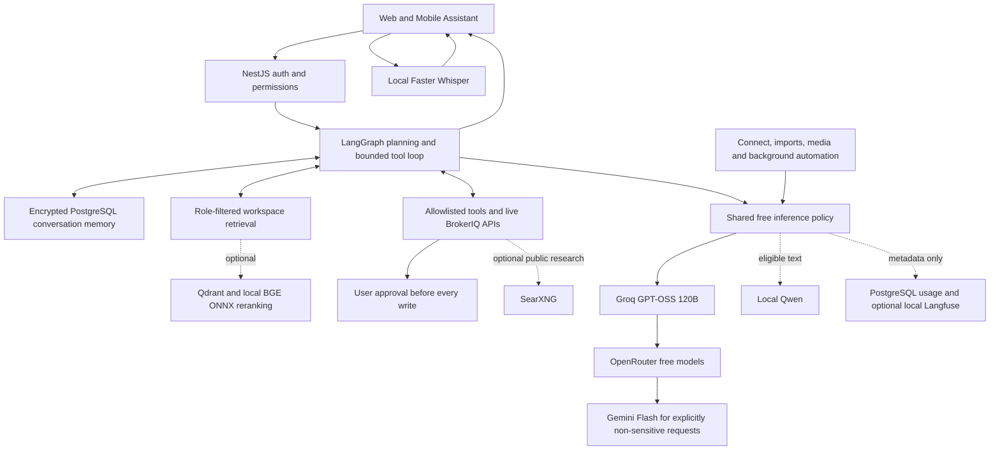

# BrokerIQ Hybrid AI

## Credentials and quotas

Install keys through Super Admin → Settings → Integrations. Reuse the existing OpenRouter credential. The request always sets zero maximum pricing. Private requests also require zero data retention and deny provider data collection.

Use a billing-disabled Groq Free-tier project for `openai/gpt-oss-120b`. Enable and confirm its zero-data-retention controls before allowing private requests. BrokerIQ caps Groq and OpenRouter at 1,000 attempts per day each. Upstream minute and token limits may be lower. Reserve capacity in PostgreSQL before each upstream call, including retries. Temporarily skip throttled endpoints and restore priority after their cooldown.

Use a billing-disabled Google AI Studio project for `gemini-3.8-flash`. Enter the actual requests-per-day quota for that project. Only server-constructed inputs explicitly marked non-sensitive may use Gemini, including the floor codes from PDF Inventory. Private summaries, CRM tool results, attachments and free-form prompts remain outside the Gemini route. No grounded Google Search or other paid model extensions are requested.

## Serving and persistence

- The Assistant is shared by Web and Mobile. The existing WebSocket progress stream reports retrieval, compose, fallback and confirmation. Confirmed tools still use the active caller’s existing API guards and validation.
- Encrypted chat memory is limited to 16 recent messages and expires after 30 days. Clearing history advances a revision so an in-flight reply cannot restore it. Workers remove expired records. Saved history omits tool results and approval tokens, so the Assistant retrieves the records again under current grants.
- The workspace guide tool checks current module policy and delegated grants. It uses lexical search when the optional vector service is absent. The vector worker indexes descriptions from the application registry. The NestJS boundary verifies every returned key again. Business records are still fetched from authoritative role-scoped APIs.
- Assistant audio uses the same local Faster Whisper model as Connect. Configure the existing `CONNECT_WHISPER_MODEL` and `CONNECT_WHISPER_PYTHON` on the API host. Existing on-device speech playback remains the voice output path.
- The optional Langfuse exporter sends timing, status and token metadata only. Run self-hosted Langfuse v4 on loopback port 18093, create a project in the integration panel and enable `AI_LANGFUSE_LOCAL_ENABLED`. PostgreSQL `AiUsage` remains the default.
- Interactive exhaustion returns a temporary-unavailability message. Existing Connect and Organic jobs defer when a quota makes a retry possible.

## Optional Docker services

The Compose file in `deploy/assistant` keeps SearXNG and the ranker loopback-only. Qdrant is reachable only on the internal knowledge network. Set `BROKERIQ_SEARXNG_SECRET` before starting the research profile. Enable `ASSISTANT_PUBLIC_SEARCH_ENABLED` only after verifying the local JSON API. The search tool accepts a fixed Gurugram topic and an optional sector and surfaces links only from the configured government domains.

To run the knowledge profile, supply reviewed ONNX exports and the matching `tokenizer.json` in `embedding/` and `reranker/` under `BROKERIQ_KNOWLEDGE_MODEL_DIR`. Both directories need `model.onnx` and any referenced external data files. Use BAAI BGE-M3 for the 1,024-dimensional dense embeddings and BGE-Reranker-v2-M3 for reranking. Pin the model revisions and container digests, check capacity, and test local rank and permission revocation before enabling `ASSISTANT_VECTOR_KNOWLEDGE_ENABLED`.

The local Qdrant 1.18.0 smoke test loaded the following quantized files. With the 43 real module descriptions, an inventory query ranked Inventory first. The same query excluded the already-indexed module when it was missing from the permitted keys.

| File | Tested SHA-256 |
| --- | --- |
| `embedding/model.onnx` | `2237f770aad5c71bbc1fc2d361a57f9a37400574cc9eff32626f0cdb49234730` |
| `embedding/tokenizer.json` | `249df0778f236f6ece390de0de746838ef25b9d6954b68c2ee71249e0a9d8fd4` |
| `reranker/model.onnx` | `912fc1215c2dbff6499700534bd8d31253af01573861abbfc43afd1fab6cce5d` |
| `reranker/tokenizer.json` | `8bf8afbfd11306bd872018c53bfdf2e160a56f8edbcf49933324404791c148d3` |

## Rollout gates

1. Apply the two additive migrations to a restored copy. Run the API permission and quota regressions, Web and Mobile checks and the signed Android upgrade.
2. With real, billing-disabled provider credentials, test private Groq tool calling, OpenRouter zero-cost fallback and Gemini non-sensitive fallback. Confirm a private vision route for property media and scanner workflows as part of this check. The existing OpenRouter key returned 404 for the live zero-cost, zero-data-retention tool-call probes. Keep the currently active release until a suitable endpoint is confirmed.
3. Verify each optional worker separately before enabling its server flag. The branch supplies the SearXNG and Qdrant/BGE Compose profiles. Langfuse remains a separate self-hosted deployment.
4. Vercel AI SDK, external MCP transport, Redis/BullMQ, Docling, assistant-controlled browsing, Kokoro TTS, arbitrary code execution and user-authored scheduled Assistant workflows require further implementation. This release retains the current HTTP model transport, restricted Zod-backed tools, PostgreSQL jobs, Poppler/Tesseract and native speech playback.
